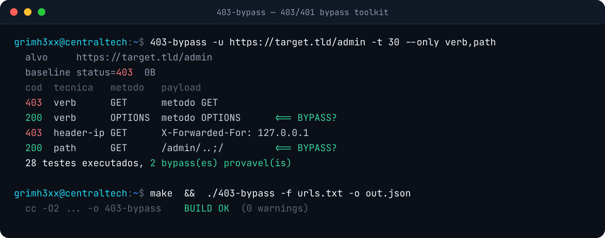

# 403-bypass

Ferramenta rápida, escrita em **C**, para testar bypasses de respostas
**403 Forbidden** e **401 Unauthorized** durante testes de segurança
**autorizados** (pentest, bug bounty, CTF).

Inspirada em projetos como `nomore403`, porém reescrita do zero em C puro
com **libcurl + pthreads**: binário único, sem runtime, altamente concorrente.



> ⚠️ **Uso autorizado apenas.** Rode somente contra sistemas que você tem
> permissão explícita para testar. O uso contra terceiros sem autorização
> é ilegal. Você é o único responsável pelo uso desta ferramenta.

## Recursos

- **Verb tampering** — testa ~18 métodos HTTP (GET, POST, PUT, PATCH,
  TRACE, PROPFIND, MKCOL, ...).
- **Headers de IP interno** — `X-Forwarded-For`, `X-Real-IP`,
  `X-Custom-IP-Authorization`, `CF-Connecting-IP` e vários outros,
  combinados com `127.0.0.1`, `localhost`, `::1`, etc.
- **Reescrita de URL por header** — `X-Original-URL`, `X-Rewrite-URL`,
  `Referer`, ...
- **Mutações de path** — `/path/`, `/path/..;/`, `/%2e/path`, `/path%20`,
  `/path?`, `/path.json`, e dezenas de variações.
- **Troca de caixa** no caminho.
- **Unicode / double-encoding** de path: `%252f`, `%c0%af`, `%e0%80%af`,
  `%u002f`, `%ef%bc%8f` (fullwidth), entre outros.
- **Modo batch** (`-f urls.txt`): testa várias URLs de uma vez (ou via stdin).
- **Wordlists externas**: `--headers` (nomes de header) e `--paths`
  (mutações de path, usando `%s` como o caminho alvo).
- **Saída estruturada** JSON ou CSV (`-o saida.json` / `-o saida.csv`) para
  integrar com outras ferramentas.
- **Baseline inteligente**: faz a requisição original primeiro e compara
  status, tamanho do corpo e nº de palavras — marca como `BYPASS?` o que
  escapa do 4xx ou retorna conteúdo diferente.
- **Concorrência real** via pool de threads POSIX.
- Suporte a **proxy** (Burp/ZAP), **rate limit**, **timeout**, TLS
  inseguro e seleção de técnicas.

## Compilando

Requer um compilador C11, `make` e `libcurl` com headers de dev.

```bash
# Debian/Ubuntu/Kali
sudo apt install build-essential libcurl4-openssl-dev

make
sudo make install   # opcional: instala em /usr/local/bin
```

## Uso

```
uso: 403-bypass -u <url> [opcoes]

  -u, --url <url>        URL alvo (obrigatorio)
  -t, --threads <n>      threads concorrentes (padrao 20)
  -T, --timeout <ms>     timeout por requisicao (padrao 7000)
      --delay <ms>       atraso apos cada requisicao (rate limit)
  -x, --proxy <url>      proxy (ex: http://127.0.0.1:8080)
  -A, --user-agent <ua>  User-Agent customizado
      --ip <valor>       IP/host unico para os headers de spoof
  -k, --insecure         nao validar certificado TLS
  -L, --location         seguir redirecionamentos
  -a, --all              mostrar todos os resultados (nao so os hits)
      --only <lista>     tecnicas: verb,ip,rewrite,path,case
  -h, --help             esta ajuda
```

### Exemplos

```bash
# Varredura completa
403-bypass -u https://alvo.tld/admin

# Só verb tampering e headers de IP, passando pelo Burp
403-bypass -u https://alvo.tld/admin --only verb,ip -x http://127.0.0.1:8080

# Mais devagar, para não derrubar o alvo
403-bypass -u https://alvo.tld/painel -t 5 --delay 200

# Batch: várias URLs de um arquivo, salvando em JSON
403-bypass -f urls.txt -o resultado.json

# Wordlists próprias de headers e paths, saída CSV
403-bypass -u https://alvo.tld/x --headers hdrs.txt --paths paths.txt -o r.csv
```

O arquivo de `--paths` usa `%s` como marcador do caminho alvo, um por linha:

```
%s/
%s%2e%2e%2f
%s/admin
```

A saída CSV/JSON traz: `target, technique, method, url, headers, status,
length, words, ms, hit`.

### Lendo a saída

```
cod  tecnica     metodo    tamanho  palavras  payload
200  verb        OPTIONS       0B     0w  metodo OPTIONS      <== BYPASS?
403  header-ip   GET           0B     0w  X-Forwarded-For: 127.0.0.1
```

- **cod** — status HTTP (verde = 2xx, ciano = 3xx, vermelho = 4xx).
- **tamanho/palavras** — do corpo da resposta, para comparar com a baseline.
- **`<== BYPASS?`** — candidato promissor; **sempre valide manualmente**.

## Licença

MIT. Veja [LICENSE](LICENSE).
