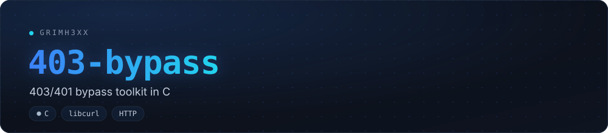
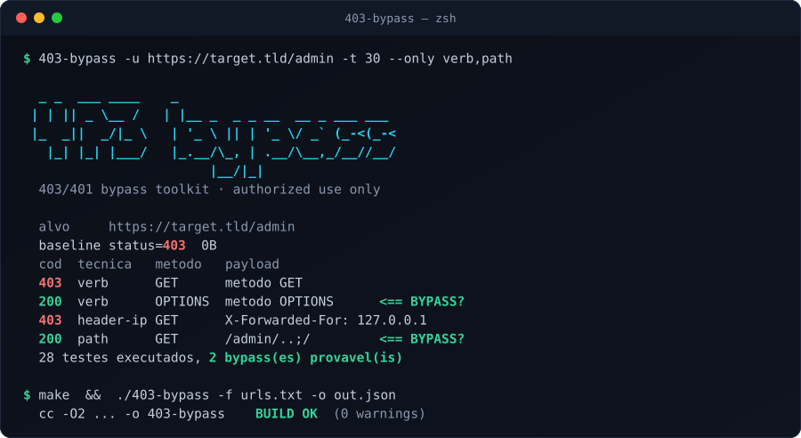

[](https://github.com/grimh3xx/403-bypass/actions)
[](LICENSE)


**Ferramenta rápida em C para testar bypasses de `403 Forbidden` e `401
Unauthorized`.** Inspirada em `nomore403`, porém reescrita do zero com
**libcurl + pthreads**: binário único, sem runtime, altamente concorrente.

<p align="center">
  
</p>

> ⚠️ **Uso autorizado apenas.** Rode somente contra sistemas que você tem
> permissão explícita para testar (pentest, bug bounty, CTF). O uso sem
> autorização é ilegal — a responsabilidade é inteiramente sua.

## Features

| | |
|---|---|
| **Verb tampering** | ~18 métodos HTTP: `GET`, `POST`, `PUT`, `PATCH`, `TRACE`, `PROPFIND`, `MKCOL`, `DEBUG`... |
| **Headers de origem** | `X-Forwarded-For`, `X-Real-IP`, `X-Custom-IP-Authorization`, `CF-Connecting-IP` e outros, com `127.0.0.1`, `localhost`, `::1`... |
| **Reescrita de URL + Host** | `X-Original-URL`, `X-Rewrite-URL`, `Referer`... e spoof de **`Host`** (`localhost`, `127.0.0.1`...) |
| **Mutações de path** | `/path/`, `/path/..;/`, `/%2e/path`, troca de caixa, e **Unicode/double-encoding** (`%252f`, `%c0%af`, `%ef%bc%8f`) |
| **Técnicas combinadas** | `--combine` cruza header+path e verb+path num mesmo request |
| **Autenticado** | `-H 'Cookie: ...'` (repetível) aplica headers fixos a toda requisição |
| **Match / filter** | estilo ffuf: `-mc`/`-fc` (status), `-fs` (tamanho), `-fw` (palavras) |
| **Anti falso-positivo** | calibra com um path aleatório (soft-404/wildcard) antes de comparar |
| **Reproduzir** | imprime o `curl` exato de cada hit (e grava na coluna `curl` do JSON/CSV) |
| **Evasão de rate-limit** | backoff automático em `429`, `--retries`, `--random-agent`, `--http1.0/--http2` |
| **Concorrência** | pool de threads POSIX com barra de progresso — binário único, sem runtime |
| **Batch & wordlists** | `-f urls.txt` (ou stdin), `--headers` e `--paths` para listas próprias |
| **Saída** | `JSON`/`CSV` (`-o`), modos `-s` (quiet) e `-v` (verbose) |

## Quick start

Requer um compilador C11, `make` e `libcurl` com headers de dev.

```bash
# Debian/Ubuntu/Kali
sudo apt install build-essential libcurl4-openssl-dev
git clone https://github.com/grimh3xx/403-bypass && cd 403-bypass

make
./403-bypass -u https://alvo.tld/admin      # varredura completa
sudo make install                           # opcional: /usr/local/bin
```

## Uso

```text
uso: 403-bypass (-u <url> | -f <arquivo>) [opcoes]

requisicao
  -H, --header <h>       header fixo em TODA req (ex: 'Cookie: a=b'); repetivel
  -A, --user-agent <ua>  User-Agent customizado
      --random-agent     rotaciona o User-Agent por requisicao
  -x, --proxy <url>      proxy (ex: http://127.0.0.1:8080)
      --http1.0 / --http1.1 / --http2   forca a versao de HTTP
      --ip <valor>       IP/host unico para os headers de spoof
  -k, --insecure         nao validar certificado TLS
  -L, --location         seguir redirecionamentos

desempenho
  -t, --threads <n>      threads concorrentes (padrao 20)
  -T, --timeout <ms>     timeout por requisicao (padrao 7000)
      --delay <ms>       atraso apos cada requisicao (rate limit)
      --retries <n>      retries em erro de transporte

tecnicas
      --only <lista>     verb,ip,rewrite,path,case,host (padrao: todas)
      --combine          tambem testa tecnicas combinadas (header+path, verb+path)
      --headers <arq>    wordlist de nomes de header extra
      --paths <arq>      wordlist de mutacoes de path ('%s' = path alvo)

match / filter (estilo ffuf)
      -mc <lista>        so conta como hit estes status (ex: 200,302)
      -fc <lista>        ignora estes status
      -fs <lista>        ignora estes tamanhos de corpo
      -fw <lista>        ignora estas contagens de palavras
      --no-calibrate     nao calibrar com path aleatorio

saida
  -o, --output <arq>     salva em arquivo ('-' = stdout)
      --format <fmt>     json | csv (inferido da extensao de -o)
  -a, --all              mostra todos os resultados, nao so os hits
  -s, --quiet            so hits e resumo (sem banner/tabela)
  -v, --verbose          mostra erros de transporte
      --no-curl          nao imprimir o curl reproduzivel
```

### Exemplos

```bash
# Area autenticada, aceitando so 200/302 como bypass
403-bypass -u https://alvo.tld/admin -H 'Cookie: session=...' -mc 200,302

# Tudo + combinadas + rotacao de UA, salvando em JSON (com curl de cada hit)
403-bypass -u https://alvo.tld/admin --combine --random-agent -o saida.json

# Batch por um proxy, filtrando o tamanho da pagina de erro padrao
403-bypass -f urls.txt -x http://127.0.0.1:8080 -fs 0

# Wordlists próprias de headers e paths, saída CSV
403-bypass -u https://alvo.tld/x --headers hdrs.txt --paths paths.txt -o r.csv
```

O arquivo de `--paths` usa `%s` como marcador do caminho alvo, um por linha
(`%s/`, `%s%2e%2e%2f`, `%s/admin`). A saída CSV/JSON traz: `target, technique,
method, url, headers, status, length, words, ms, hit, curl`.

### Lendo a saída

```text
cod  tecnica     metodo    tamanho  palavras  payload
200  verb        OPTIONS       0B     0w  metodo OPTIONS      <== BYPASS?
403  header-ip   GET           0B     0w  X-Forwarded-For: 127.0.0.1
```

- **cod** — status HTTP (verde = 2xx, ciano = 3xx, vermelho = 4xx).
- **tamanho/palavras** — do corpo da resposta, comparados com a baseline.
- **`<== BYPASS?`** — candidato promissor; **sempre valide manualmente**.

## Testes

Há um teste end-to-end que sobe um mock server e verifica que o scanner
realmente detecta os bypasses (via método, header e path) e respeita o
`match-code`. Roda no CI a cada push:

```bash
make test
```

## Arte

O banner e o demo são gerados pela toolchain de marca do perfil:

```bash
python3 tools/gen_banner.py    # docs/banner.svg + social-preview.svg
python3 tools/gen_demo.py      # docs/demo.svg + docs/demo-light.svg
```

## Licença

MIT. Veja [LICENSE](LICENSE).
